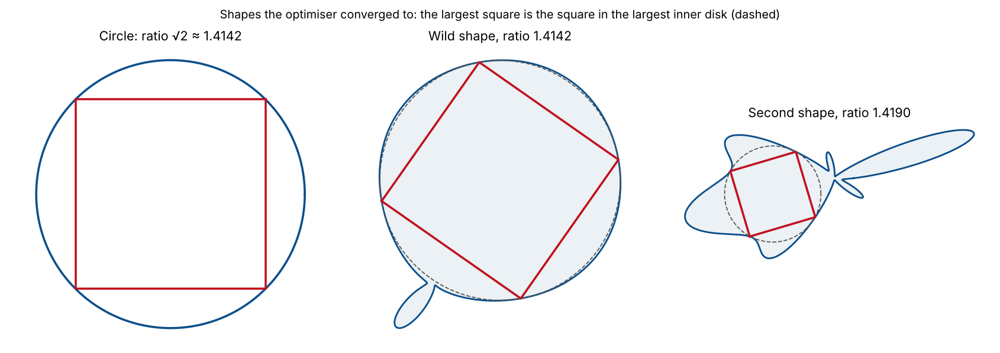

# v242: Hunting for curves with only small squares

**Research program:** Benjamin John Schulz  
**19 November 2026**  
**Status:** Numerical experiment plus a first-order calculation. **Not a proof.** No counterexample found.

> **v243 correction (19 November 2026):** The phrase “no counterexample” below means **none was found in this numerical experiment**, not that the sharp constant is true. Daniel Bernier [reported on August 17, 2026](https://dbernier.ca/2026/06/16/the-sharp-big-peg-conjecture/) that Grisha Pochuev supplied a **10-sided counterexample** to the **sharp** sqrt(2) polygonal Big Peg conjecture. This repo has not independently verified that polygon, since exact coordinates were not available in machine-readable form during v243. The unrestricted **some c>0** Big Peg question remains open. See [v243 exact polygon method](v243-exact-polygon-big-peg-census.md). The floor shapes and first-order expansion are numerical/local observations, not universal theorems.

> **Later v244 update:** [The original ten exact rational vertices and an independent exhaustive verification](v244-independent-pochuev-certificate.md) are now available in this repository. The v243 lack-of-coordinates statement above is a historical note only.

## The question

Write J(γ) = (side of the largest square inscribed in γ) / (inradius of γ), where the inradius is the radius of the largest disk inside γ. A circle has J = √2.

Matschke's survey notes that if every smooth curve containing a disk of radius r inscribed a square of side at least √2·r, or even just εr for some fixed ε > 0, then the standard approximation argument would prove Toeplitz ([survey](https://pure.mpg.de/pubman/item/item_3120610_1/component/file_3120611/Matschke_Survey%20on%20the%20square_oa_2014.pdf), §1). The reason is that the inradius cannot drop suddenly under uniform limits, so squares of side at least c·inradius cannot shrink to a point. v242 tests that condition at its sharp constant: **is J ≥ √2 for every smooth Jordan curve?**

## Result

**Nothing went below √2.** The optimisers kept converging onto the floor J = √2, and every apparent sub-√2 hit turned out to be an artefact.

| What | Shapes | Smallest verified J |
|---|---|---|
| CMA-ES, star-shaped, 4–24 Fourier modes (12 usable runs) | ~20,000 evaluated | **1.414216** (√2 = 1.414214) |
| CMA-ES, general non-star curves, 4 modes | ~1,000 | 1.417801 |
| Random general curves | 995 | 1.4426 |
| Notched circles (n = 3–16 notches) | 32 | 2.828 |
| Starfish arms (n = 3–13) | 24 | 1.414 |
| Double log spirals, a = 0.3, 0.5 | 2 | 2.573 |
| Regular polygons, Reuleaux triangle, ellipse 2:1 | 9 | 1.4641 (hexagon, 12-gon) |

The exact values check the finder: triangle 6(2−√3) = 1.6077, hexagon 2√3−2 = 1.4641, ellipse 2:1 side 4/√5. All shapes and verified values are in [`v242-small-squares-hunt.json`](v242-small-squares-hunt.json).

## The floor shapes

The optimiser does not just rediscover the circle. It also finds wild shapes that sit on the floor; the middle one spans a 132:1 range of distances from the origin. In each of them, the largest square is exactly the square inscribed in the largest inner disk. The curve touches that disk at four points 90° apart and has no bigger square anywhere else.

So if J ≥ √2 is true, its equality cases are not just circles. They are curves that touch their largest inner disk at the four corners of a square, with nothing larger elsewhere.

## A first-order calculation that predicts the floor

Take r(θ) = 1 + ε·h(θ) with h smooth. To first order, a square near one inscribed in the unit circle has its vertices at angles αⱼ = φ + jπ/2, centre εc and circumradius 1 + εt. The four on-curve conditions are

  t + Re(c·e^{−iαⱼ}) = h(αⱼ),  j = 0, 1, 2, 3.

Summing them gives t = H(φ)/4, where H(φ) = Σⱼ h(αⱼ). They can be solved for c exactly when

  D(φ) = h(φ) − h(φ+π/2) + h(φ+π) − h(φ+3π/2) = 0.

Since D(φ+π/2) = −D(φ), such φ always exist. At a simple zero, the square continues to a genuine inscribed square of side √2·(1 + εH(φ)/4) + O(ε²).

The inradius is 1 + ε·ι + O(ε²), where ι = max over c of minᶿ [h(θ) − Re(c·e^{−iθ})]. For every φ and every c, the four terms Re(c·e^{−iαⱼ}) sum to zero, so

  H(φ)/4 = ¼ Σⱼ [h(αⱼ) − Re(c·e^{−iαⱼ})] ≥ minᶿ [h(θ) − Re(c·e^{−iθ})].

Choosing the best c gives H(φ)/4 ≥ ι for every φ. Hence **J ≥ √2 + O(ε²)** near every circle. Equality at first order needs all four αⱼ to be minima of h − Re(c·e^{−iθ}). That means the curve touches its shifted largest inner disk at four points 90° apart, which is exactly the floor family the optimiser found.

This is a formal first-order computation. It assumes D has a simple zero, which is the generic case. It does not show that J ≥ √2 far from circles.

## False alarms, and the guards they forced

- **Floating-point overflow.** The first unconstrained runs drifted to shapes whose radius varied by a factor of about e⁵⁰⁰, which double precision cannot represent, and reported J = 0. They are recorded as *discarded*. Later runs cap the spread at e⁵ (about 150), which still allows very wild shapes.
- **Resolution traps.** Two runs reported J = 1.168 and 1.075 because the coarse grid (192) missed the largest square. At grids of 768, 1536 and 1024 (with the second finder), the true values are 1.620 and 1.703. A missed square can only make J look *smaller*. So every value is verified at high resolution with both finders, and the optimiser now re-checks any J < 1.45 inside the loop.

## Method

- **Square finder.** Fix two curve points as opposite (or adjacent) vertices. The other two vertices are then forced; find where both land on the curve, using sign changes on an M×M grid of point pairs, then vectorised Newton.
- **Cross-checks.** Two independent parametrisations, several resolutions, the parity theorem (generic counts come out odd), and exact values for the ellipse, triangle and hexagon.
- **Inradius.** Grid search over interior points, then Nelder–Mead on the exact distance to the polygon.
- **Shapes.** Star-shaped curves r = exp(Σ aₖ cos kθ + bₖ sin kθ), which are always Jordan; and general Fourier curves e^{iθ} + Σ cₖ e^{ikθ}, keeping only simple ones.
- **Search.** CMA-ES minimising J, with the spread cap and the in-loop re-check.

## Limits

- **Numerical, not a proof.** An optimiser can miss narrow valleys.
- **Limited search depth.** The general (non-star) search only went to 4 Fourier modes, and the star-shaped search to 24.
- **Smooth curves only.** The question is about smooth curves, which is exactly where the approximation argument needs it.
- **Nearest rigorous result.** Pettersson, Tverberg and Östergård proved by computer that every Jordan curve in the 12×12 grid inscribes a square at least 1/√2 times the largest axis-parallel square inside it (cited in Matschke's survey).

## What it suggests

1. **Try to prove J ≥ √2 for convex curves first.** The floor shapes suggest the mechanism. The largest inner disk carries a whole circle of squares of side √2·r. Push that family outward onto the curve and show at least one square survives at that size.
2. **Make the first-order calculation rigorous near circles,** then extend it to curves within a fixed distance of a circle, in the spirit of Chambers' near-C² theorem.
3. **Search wider:** general curves with more modes, and teeth that bend or hook, which star-shaped curves cannot make.

## Reproduce

~~~sh
pip install numpy scipy            # cma too, for new searches
python code/small_squares_hunt_v242.py              # replay checks, about 20 s
python code/small_squares_hunt_v242.py --reverify   # re-verify every recorded run (slow)
python code/small_squares_hunt_v242.py --search 16 21 150
REQUIRE_NUMERIC_DEPS=1 python -m unittest -v tests.test_small_squares_hunt_v242
~~~
