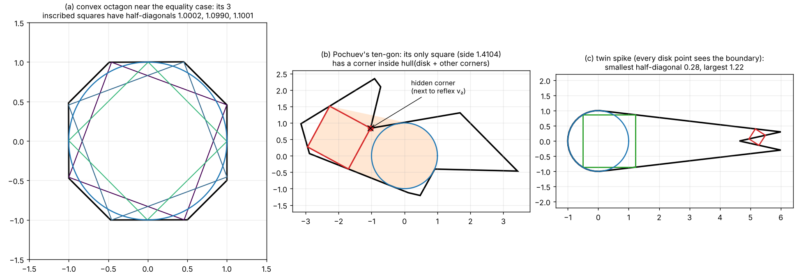

# v255: the sharp sqrt(2) Big Peg bound holds for convex curves

**Research program:** Benjamin John Schulz  
**Date:** 19 November 2026  
**Status:** Short pen-and-paper theorem with a curve-free lemma, an exact-arithmetic Pochuev certificate, and computational checks. The proof does not depend on any computation. Not a proof of the unrestricted Toeplitz conjecture or of the weak Big Peg problem (some universal c > 0) for general Jordan curves.

## Summary

Pochuev's ten-gon (v244) shows the sharp constant sqrt(2) fails for general polygons. v255 shows it **holds for every convex curve**, in a strong form: *every* inscribed square of a convex curve that contains a disk of radius r has side at least sqrt(2) r, not just the largest. Equality happens only for a square inscribed in the disk whose four corners are points where the curve touches the disk.

The proof rests on a lemma about one square and one disk, with no curve in it. The lemma also explains exactly what any counterexample must do: one corner of every small square has to sit in a pocket. Pochuev's square does this. Its one hidden corner lies on the edge leaving his reflex vertex v2, 6.45e-5 away from it, certified in exact rational arithmetic.

## Statements

Throughout, D is a closed disk of radius r centred at 0. A square has centre p, half-diagonal h (so side = sqrt(2) h), and perpendicular unit diagonal directions u, v = Ju. Its vertices are p +- h u and p +- h v.

**Hidden-corner lemma.** Suppose no vertex of the square lies in the open disk int D. If h < r (side < sqrt(2) r), then some vertex V lies in the interior of conv(D U {the other three vertices}).

If h = r and no vertex is hidden, then p = 0: the square is inscribed in the circle bounding D.

**Theorem (convex curves).** Let K be a compact convex set containing D. Then every square whose four vertices lie on the boundary of K has side >= sqrt(2) r. Equality holds only for a square inscribed in the boundary circle of D whose four vertices are contact points of the boundary of K with that circle.

**Corollary (sharp Big Peg for convex curves).** A convex Jordan curve whose interior contains a disk of radius r inscribes a square of side >= sqrt(2) r.

Existence of an inscribed square for every convex curve is classical (Emch 1913 and 1916 for smooth convex curves, Zindler 1921 and Christensen 1950 for all convex curves; see Matschke's survey). The theorem also makes the usual limit argument non-degenerate: approximate by smooth strictly convex curves containing slightly smaller disks. Each approximant's squares have side at least sqrt(2)(r - epsilon), so a limit square cannot collapse.

## Proof of the lemma

Scale so r = 1. Suppose no vertex is hidden. We show h >= 1. Put x = |p.u| and y = |p.v|. The diagonal line l_u = {p + t u} lies at distance y from 0, and l_v lies at distance x.

**Step 1: a diagonal line through the open disk.** Suppose y < 1. Then l_u meets D in the chord t in I = [-p.u - sqrt(1 - y^2), -p.u + sqrt(1 - y^2)], whose interior points lie in int D. The vertices sit at t = +-h, and neither is in int D, so the open interval int I avoids +-h. Therefore int I lies inside (-h, h), or entirely beyond one vertex.

If it lay beyond, say beyond V = p + h u, then V would sit strictly between the opposite vertex V' = p - h u and a point z in int D. A point on the half-open segment from an interior point z of a convex set to another point of it is interior, so V would be in int conv(D U {V'}): hidden. Hence I lies in [-h, h], which gives

    h >= |p.u| + sqrt(1 - y^2) = x + sqrt(1 - y^2).      (1)

Likewise, if x < 1, then h >= y + sqrt(1 - x^2).    (2)

**Step 2: cases with some diagonal line through the disk.**
- *x < 1 and y < 1.* If both right sides of (1) and (2) were < 1, squaring would give y^2 > 2x - x^2 and x^2 > 2y - y^2. Adding gives x^2 + y^2 > x + y, which is impossible for x, y in [0, 1]. So h >= 1.
- *y < 1 <= x* (or the mirror case). By (1), h >= x + sqrt(1 - y^2) > 1.

**Step 3: both diagonal lines miss the open disk (x >= 1 and y >= 1).** Suppose h < 1. After reflections, take u = e1, v = e2 and p = (X, Y) with X = x >= 1 and Y = y >= 1. Reflections preserve D and the hull condition. Then X - h > 0 and Y - h > 0.

Look at the vertex A = (X - h, Y). Since A is not hidden, some unit vector n supports conv(D U {B, C, A''}) at A, where B = (X, Y - h), C = (X, Y + h) and A'' = (X + h, Y). The conditions n.(B - A) <= 0 and n.(C - A) <= 0 force n = (-cos phi, sin phi) with |phi| <= pi/4. The disk condition gives

    1 = max over D of n.q <= n.A = -cos(phi)(X - h) + sin(phi) Y <= sin|phi| (Y - X + h),

using cos(phi) >= sin|phi| and X - h > 0. The right side is <= 0 unless Y - X + h > 0, and is at most (Y - X + h)/sqrt(2) in any case. So Y - X + h >= sqrt(2).

The vertex B gives X - Y + h >= sqrt(2) in the same way. Adding the two, h >= sqrt(2), contradicting h < 1. So h >= 1.

**Equality.** If h = 1 and no vertex is hidden, Step 3 is impossible (it would force h >= sqrt(2)), and the mixed case of Step 2 gives h > 1. So x, y < 1 and both right sides of (1) and (2) are <= 1. That forces x^2 + y^2 >= x + y with x, y in [0, 1), so x = y = 0 and p = 0. Conversely, a square inscribed in the circle has no hidden corner: at each corner, the tangent line to the circle supports everything. QED.

## Proof of the theorem

Boundary points of K are not in int D, because int D lies in int K. If an inscribed square had h < r, the lemma would give a vertex V in int conv(D U {other vertices}). That set lies in int K, because D and the other three vertices lie in the convex set K. So V would be an interior point of K, not a boundary point. In the equality case the lemma gives p = 0 and h = r, so the vertices lie on the circle and on the boundary of K. QED.

## What the lemma says beyond convexity

- **Any Jordan curve.** Let the curve's interior contain D. Every inscribed square with side < sqrt(2) r has a corner V on the curve lying in int conv(D U {other corners}). Every small square, and therefore every counterexample to the sharp bound, needs a corner tucked behind the hull of the disk and the other three corners: a pocket. This is a pure necessary condition, and it applies to every small square, not only the largest.
- **Regions where every point of D sees the whole boundary (D in the kernel).** Step 1 holds directly: a line through a point of int D meets the boundary exactly twice, once on each side of that point. So a small square must have both diagonal lines missing the open disk (Step 3's configuration). Such squares do exist (twin spikes below), so the "every square" form fails outside convexity. The weak form (largest square) is open there.
- **Pochuev's ten-gon (exact, `pochuev_certificate`).**
  - His unique square has side^2 = 1.98920732219 < 2. Its centre is 2.0599 from the disk centre, and both diagonal lines miss the unit disk (squared distances 1.2037 and 3.0394), which is Step 3's configuration.
  - Exactly one corner is hidden: (-69249224071669/67342217813040, 282297237611291/336711089065200), which is about (-1.028318, 0.838396).
  - That corner lies on edge 2, which leaves the reflex vertex v2 = (-1234, 1006)/1200, at distance 6.45e-5 from v2.
  - An independent barycentric certificate puts it strictly inside the triangle formed by z = (-7/10, 7/10), a point of the open unit disk, and two other corners.
  - The polygon's reflex vertices are v2 and v9. It is star-shaped, but its exact rational kernel lies at distance sqrt(19452159841/13579065000) = 1.19688 from the disk centre. So no point of the disk, not even its centre, sees the whole boundary.

## Computational support

The exact checks use the standard library and `fractions.Fraction` (`python code/convex_big_peg_v255.py`):

- **Exact hidden-corner decision.** For a corner V with w = V - p, the supporting directions of the square at V form the closed cone within 45 degrees of w. V is not hidden iff some n in that cone has n.V >= r. The maximum of n.V over the cone is |V| when V is within 45 degrees of w, and (w.V + |Jw.V|)/(sqrt(2) h) otherwise. All comparisons reduce to rational inequalities.
- **Lemma, exact grid.** 14,024 rational squares with no corner in the open unit disk and h < 1 were tested, and every one has a hidden corner. Of 1,630 squares with h = 1 exactly, the only six without a hidden corner are centred at the disk centre.
- **Lemma, float sweep.** 100,000 seeded random small squares, about 30% of them with h in [0.95, 1), produced no exception.
- **Convex polygons, exact complete censuses (v223).** Ten rational convex polygons containing the unit disk were censused: five hand-made, four seeded random, and one octagon close to the equality configuration. Every inscribed square has side^2 >= 2. The octagon's smallest square has side^2 = 2.000957, within 0.05% of equality.

Numeric checks need numpy, scipy and cma (`--numeric --write` regenerates [the JSON record](v255-convex-big-peg-checks.json)):

| Check | What it does | Result |
|---|---|---|
| Random convex polygons | 3,000 seeded convex polygons (3 to 12 sides, all support values >= 1), every inscribed square | 4,570 distinct squares; smallest half-diagonal / inradius = **1.00192** |
| Optimizer trying to break the theorem | CMA-ES minimising the *smallest* inscribed half-diagonal over convex n-gons containing the unit disk, n = 4, 5, 6, 8 | 1.0000000011, 1.0000011, 1.0000035, 1.00059: it reaches the equality shapes and never goes below 1 |
| Twin spikes | Union of conv(D U T1) and conv(D U T2) with the arc replaced by a circumscribed polyline, so every edge line is tangent to the unit circle and every point of D sees the whole boundary; tip gap 0.3 to 1.6 | Five distinct squares each. Smallest half-diagonals **0.147 to 0.622** (4 small squares out in the spikes), largest 1.19 to 1.34: the "every square" form fails, the largest-square form survives |
| D in the kernel | CMA-ES minimising the *largest* half-diagonal; every edge line at distance >= 1 from the centre; n = 5 to 10, 10 runs | Lowest reached **1.000124**; no counterexample |
| Star-shaped about the centre only | Same, with the unit disk inside but edge lines allowed to cut it (pockets the disk cannot see); n = 6 to 12, 12 runs | Lowest reached **1.000034**; no counterexample |
| Pochuev pushed into that class | Start at his ten-gon and penalise failure to be star-shaped about the disk centre, keeping the disk inside | Both runs became star-shaped; the largest half-diagonal went from 0.9973 to **1.0015** (seed 0) and **1.134** (seed 7). His small square does not survive, though seed 0 ends close to the bound |

*(a) A convex octagon near the equality configuration, with all three of its inscribed squares (half-diagonals 1.0002, 1.0990 and 1.1001, with r = 1). (b) Pochuev's ten-gon: his only square (red), its hidden corner, and the hull of the disk and the other three corners (shaded). (c) A twin-spike region, star-shaped about every point of the disk, with its smallest (red) and largest (green) squares.*

## Limits and provenance

- **Literature.** I could not find this argument stated anywhere. Matschke's second square-peg paper does not discuss convex curves in connection with square size, and its only size result is the annulus theorem. Bernier's prize page was not reachable from this session. The argument is short enough that it may be folklore, so a literature check is needed before any priority claim.
- **Scope.** The theorem says nothing about the unrestricted Toeplitz problem or about the weak Big Peg (some universal c > 0) for general Jordan curves.
- **The searches are evidence, not proof.** The searches over star-shaped classes are small (CMA-ES, n <= 12, random starts plus one targeted push from Pochuev's polygon). As v242 showed, random-start search can miss sharp-cornered pocket constructions.
- **Consistency with v242.** The equality characterization matches v242's numerical floor: shapes touching their incircle at four points 90 degrees apart reach the floor exactly there.

## Open targets

1. **Weak sqrt(2) for regions star-shaped about the whole disk (D in the kernel).** Squares whose diagonal line crosses the disk are already big. What is needed is a topological reason that the largest square is of that kind.
2. **Weak sqrt(2) for curves star-shaped about the disk centre only.** Searches found nothing below the bound. Pushing Pochuev's polygon into this class destroys his small square, although one run ends only 0.15% above the bound, so this class deserves a more serious adversarial search before any conjecture.
3. **Weak Big Peg, some c > 0, in general.** The lemma turns "small square" into "corner in a pocket behind the disk". Bounding how pockets can host all corners of all large squares is a concrete way into the general problem.

## Reproduce

    python code/convex_big_peg_v255.py                     # exact part, standard library
    python -m unittest -v tests.test_convex_big_peg_v255    # exact + numeric tests
    python code/convex_big_peg_v255.py --numeric --write   # regenerate the JSON (numpy, scipy, cma)
    python code/convex_big_peg_v255.py --figure            # regenerate the figure (adds matplotlib)
